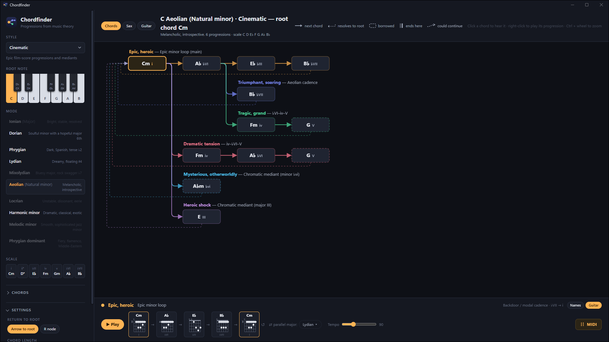
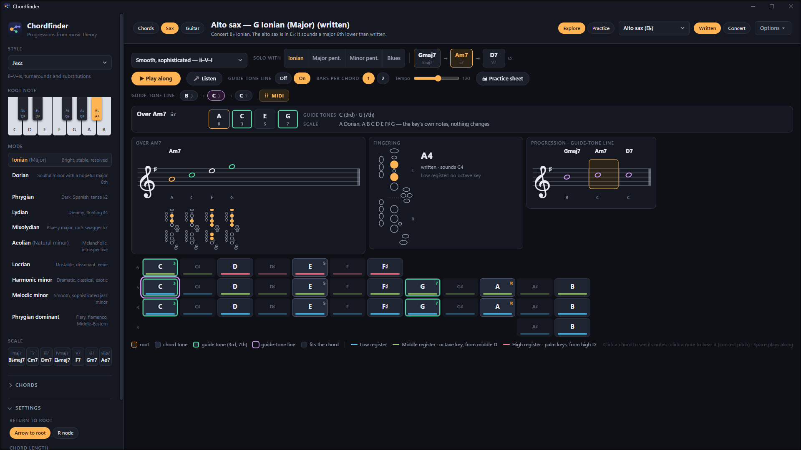

# Chordfinder

> [!NOTE]
> This is a vibe-coded app I made for my own use. I'm sharing it in case anyone else finds it useful, but there's no guarantee it will be maintained.

**A small, fast desktop app that maps out chord progressions from music theory — and drops them straight into your DAW as MIDI.**

Pick a key and a mode, and Chordfinder draws a map of progressions that start on your root chord: the classic progression for that mode runs along the top, and variations branch off wherever they take a different turn. Every branch is labelled with its mood, and you can hear any chord or progression with a click.



## Features

- **Styles.** Pick a style from the dropdown and the whole map is rebuilt from that genre's own progressions and mood labels: **Theory**, **Pop**, **EDM**, **Kawaii future bass**, **Lo-fi / neo-soul**, **Rock**, **Ska**, **Ska-punk**, **Blues**, **Jazz**, **Cinematic**, **Synthwave**, **J-pop / anime**, **Gospel**, **Metal** and **Flamenco**, plus a **Video game** group: **Adventure** and **Vampire Hunter** (genre idioms) and **Zelda**, **Castlevania** and **Double Dragon** (transcribed from real tracks, each named). Each style also sets a fitting tempo, chord colour and chord length — 12-bar blues in dominant 7ths, Royal Road and *Just the Two of Us* moves in future bass, power-chord Phrygian riffs in metal, the Andalusian cadence in flamenco.
- **Any key, any mode.** Choose the root on a piano keyboard and a mode: Ionian (major), Dorian, Phrygian, Lydian, Mixolydian, Aeolian (natural minor), Locrian, harmonic minor, melodic minor or Phrygian dominant. Notes are spelled correctly for the key (E♭ Dorian, not D♯ Dorian).
- **Progressions grounded in theory.** Each mode comes with well-known progressions — authentic and plagal cadences, ii–V–I, the Andalusian cadence, the circle of fifths, Pachelbel's canon, Dorian and Mixolydian vamps, the Phrygian half-step pull and more.
- **A branching map.** Progressions that share opening chords share nodes, so variations branch off exactly where they diverge. Arrows show the order of the chords. The root chord stays in view as you scroll down a long map.
- **Mood labels.** Every branch is labelled with its mood and name, e.g. *"Bittersweet, tender — borrowed iv from Aeolian"*, and every ending is named from the actual chords (*Authentic cadence · V → I*, *Deceptive cadence*, *Picardy third* …).
- **Endings that make sense.** Progressions that resolve show an arrow (or a small **R** node) back to the root. Ones that end elsewhere on purpose get a final barline — plus a dotted *could continue* line to where they would naturally go next.
- **Shift to the parallel mode.** When a progression resolves, the play panel offers the parallel minor (or major) modes on the same root, e.g. C Ionian → C Aeolian or C Dorian. Each one opens a list of that mode's progressions with their chords: click ▶ to preview one, right-click ▶ to hear your progression followed by it, or click the row to switch over.
- **Alter the root chord.** Triad, 7th, dominant 7th, sus2, sus4, 6, add9, diminished, augmented or power chord. Some unlock extra branches: a dominant-7th root adds blues and gospel moves, a suspended root adds its resolution, an augmented root adds the line cliché.
- **Borrowed chords.** Optionally branch every progression with chords borrowed from parallel modes (modal interchange): iv and ♭VI in major, Dorian's IV and harmonic minor's V in minor, the Neapolitan ♭II, and more. Borrowed chords are drawn with dashed borders and named after their source mode.
- **Triads or 7th chords.** Seventh chords take their 7th from the scale the chord actually comes from, so ♭VII in major becomes ♭VII7.
- **Listen.** Click a chord to hear it, right-click to play its whole progression, or press Space. The play panel shows each chord's notes as it sounds, with adjustable tempo.
- **Guitar chord diagrams.** Switch the play panel from **Names** to **Guitar** to see a chord box under every chord: the familiar open shape where there is one, else an easy barre or movable shape.
- **Drag MIDI into your DAW.** Drag the **⠿ MIDI** button into Ableton, FL Studio, Reaper, Bitwig or any DAW that accepts MIDI files. You get the progression exactly as it plays: same voicings, your tempo, chord names as markers.
- **Phrases or loops.** Play and export a progression as a phrase (2 beats per chord, ending back on the root) or as a loop (1 bar per chord, padded to exactly 4 or 8 bars) that repeats seamlessly in your DAW.
- **Easy on your drive.** The dragged MIDI file is a short-lived temporary file that Windows keeps in memory and that is deleted a minute after the drop.
- **Native and light.** A ~3 MB executable that starts instantly and uses about 45 MB of RAM, with a title bar that matches the dark theme on Windows 11.


### Sax view

Switch the top bar from **Chords** to **Sax** for a practice view aimed at saxophone students.



- **Your instrument, your pitch.** Soprano, alto, tenor or baritone, shown in written or concert pitch. The root picker stays in concert pitch; chord symbols and keys transpose properly (concert B major's V on alto is E♭, not D♯).
- **Range grid.** Every note in the sax range (written B♭3–F♯6), one row per octave, with the octave-key and palm-key registers marked. Note names as letters, Dutch (Cis, Bes) or fixed do, with optional movable do.
- **Scales.** The mode, its pentatonics and the blues scale, played back on demand.
- **Chord tones and chord-scales.** Click a chord in the progression bar to see its chord tones, guide tones (3rd and 7th) and the scale to play over it — borrowed chords show exactly which notes change.
- **Guide-tone line and play-along.** A smooth guide-tone line through the progression and a looping backing track with count-in to practise it over (Space toggles it).
- **Staff notation.** The scale or chord arpeggio and the progression as a lead sheet, with the right key signature and clef for your instrument.
- **Fingerings.** A fingering diagram for any hovered note (standard plus common alternates) and an optional strip of mini diagrams under the staff.
- **Tuner and feedback.** Turn on the microphone to see the note you play, play phrases back by ear, or get feedback while playing along. Nothing is recorded or stored.
- **Practice mode.** Ear and reading drills — scale degrees after a cadence, chord tones over a chord, reading notes from the staff (answer by name or by playing it) — with levels and scores.
- **Practice sheet and melody MIDI.** Print the staves with the guide-tone line, or drag the scale or guide-tone line out as MIDI.

### Guitar view

Switch the top bar to **Guitar** for an overview of the neck, aimed at beginners. Guitar or bass, standard tuning.


- **The neck.** Scale notes on every string up to fret 17, labelled as note names, scale degrees or movable do. Hover a note to see the same pitch elsewhere on the neck; a left-handed option mirrors it.
- **Chords on the neck.** Click a chord in the progression row to see its chord tones and the scale to play over it, with the chord's shape ringed. Step through other shapes up the neck, or pick **Close together** so the hand barely moves between chords.
- **Positions.** The five pentatonic boxes, or three-notes-per-string patterns for the modes. Pick one and the rest of the neck fades; chord shapes stay inside it.
- **Staff and tab.** The scale position or the chosen chord, and the whole progression, in written notation with tab underneath.
- **Strumming.** A pattern per style (folk, driving eighths, offbeat skank, shuffle, gallop, fingerpicking …) or one you make yourself, shown as ↓ ↑ arrows that follow the play-along. Drag the strummed part out as MIDI.
- **Practice.** Find-the-note and name-the-note drills with levels and scores, and a string tuner.

## Download

Get the latest version from the [Releases](../../releases) page:

| Platform | File |
| --- | --- |
| Windows 10/11 | `…_x64-setup.exe` (installer) or `…_x64-portable.zip` (just unzip and run) |
| macOS (Intel and Apple Silicon) | `….dmg` |
| Linux | `….AppImage` or `….deb` |

The builds aren't code-signed, so your system may warn on first launch:

- **Windows**: SmartScreen says "Windows protected your PC" → **More info** → **Run anyway**.
- **macOS**: right-click the app → **Open** → **Open**. If macOS says the app is damaged, run `xattr -dr com.apple.quarantine /Applications/Chordfinder.app` in Terminal.

## Using it

| Do this | To |
| --- | --- |
| **Style** dropdown | Switch genre: the whole map, tempo and chord colour change |
| Click a key on the piano | Change the root note |
| Click a mode | Change the mode |
| **Chords** section | Alter the root chord, switch triads / 7th chords, turn borrowed chords on |
| Click a chord | Hear that chord |
| Right-click a chord or a label | Play the whole progression |
| Space | Play / stop the selected progression |
| Hover a branch | Highlight its full path from the root |
| **⇄ parallel minor / major** buttons | List the parallel mode's progressions: ▶ previews, right-click ▶ plays yours then that one, click a row to switch |
| Drag **⠿ MIDI** | Drop the selected progression into your DAW |
| Ctrl + mouse wheel | Zoom the map |
| **Settings** section | Return-to-root style (arrow or R node), chord length (2 beats or 1-bar loop), detailed or compact view |
| **Names \| Guitar** in the play panel | Show a guitar chord diagram under each chord |
| **Chords \| Sax \| Guitar** switch | Switch between the progression map, the sax view and the guitar view |
| Sax view: **Explore \| Practice** | Explore scales and chords, or run the practice drills (keys 1–9/0 answer, R replays, Space next) |
| Sax view: **Options ▾** | Note names, movable do, what to show (staff, grid or both), fingering strip |
| Sax view: **🖨 Practice sheet** | Print the staves with the guide-tone line |
| Guitar view: **Explore \| Practice** | Explore the neck, or run the note drills and the string tuner (keys 1–9/0 answer, Space next) |
| Guitar view: **Position**, **Shapes**, **Strum** | Limit the neck to one position, choose how chord shapes are picked, pick or edit a strumming pattern |

In the map, a solid arrow leads to the next chord, an **R** node or dashed arrow means *resolves to the root*, a `‖` bar means *ends here*, a dotted line means *could continue*, and a dashed border marks a borrowed chord.

## Building from source

Chordfinder is built with [Tauri 2](https://tauri.app): a Rust shell around a plain HTML/JS interface with no front-end build step and no npm dependencies.

**Requirements**

- Windows 10 or 11 with the Microsoft Edge WebView2 runtime (included with Windows 11)
- [Rust](https://rustup.rs) 1.77 or newer
- [Node.js](https://nodejs.org) 22 or newer — only for running the tests

**Build and run**

```bash
cargo build --release
```

The app is written to `target/release/chordfinder.exe`. For a debug build that opens straight away, use `cargo run`.

**Run the tests**

```bash
npm test
```

The tests check note spelling, chord building, every key × mode × option combination, the layout, the borrowed-chord rules, the MIDI files byte by byte, the sax view's transposition, staff layout, fingerings, pitch detection and drills, and the guitar view's chord shapes, positions, tab, strumming patterns and drills.

**Releases**

[`.github/workflows/build.yml`](.github/workflows/build.yml) builds Windows, macOS and Linux versions on GitHub Actions. Push a tag that matches `version` in `tauri.conf.json` (for example `v0.4.0`) to get a draft release with all files attached, or use **Run workflow** on the Actions tab for a test build.

## How it works

| File | What it does |
| --- | --- |
| `ui/theory.js` | The music theory: scales and spelling, chords from Roman numerals, the progression library, borrowed chords and cadence names |
| `ui/styles.js` | The genre styles: each one's progressions per mode and its defaults |
| `ui/graph.js` | Merges progressions into a branching tree and lays it out |
| `ui/midi.js` | Chord voicing (shared with the synth) and the MIDI file writer |
| `ui/audio.js` | A tiny Web Audio synth for previews and play-along |
| `ui/horn.js`, `ui/staff.js`, `ui/fingering.js` | The sax view: transposition, scales and chord-scales, staff layout, fingering charts |
| `ui/guitar.js`, `ui/strum.js`, `ui/fretquiz.js` | The guitar view: chord shapes, the neck, positions, tab, strumming patterns and note drills |
| `ui/pitch.js`, `ui/mic.js`, `ui/mic-worklet.js` | The tuner: pitch detection and microphone capture |
| `ui/quiz.js` | The practice drills and scoring |
| `ui/app.js`, `ui/index.html`, `ui/style.css` | The interface |
| `src/main.rs` | The native window, title-bar colours and the MIDI drag-out |

All the theory, layout and MIDI code is plain JavaScript without DOM access, so it runs and is tested in Node as-is.

Chords are written as Roman numerals relative to the major scale (`♭VI`, `♭VII`, `iv`, `V/V` …), the usual convention for modal and pop harmony. To add a progression, add a line to `LIBRARY` in `ui/theory.js` (or to a style in `ui/styles.js`) with its mood, name, chords and whether it resolves:

```js
p('Bittersweet, tender', 'Borrowed minor iv', ['IV', 'iv']),
```

## Platform support

Chordfinder is developed and tested on Windows. The interface itself is cross-platform, but dragging MIDI out of the app and the themed title bar are currently Windows-only. The microphone and printing have not been tested on macOS or Linux yet.

## License

[MIT](LICENSE) © 2026 Sidar Talei
