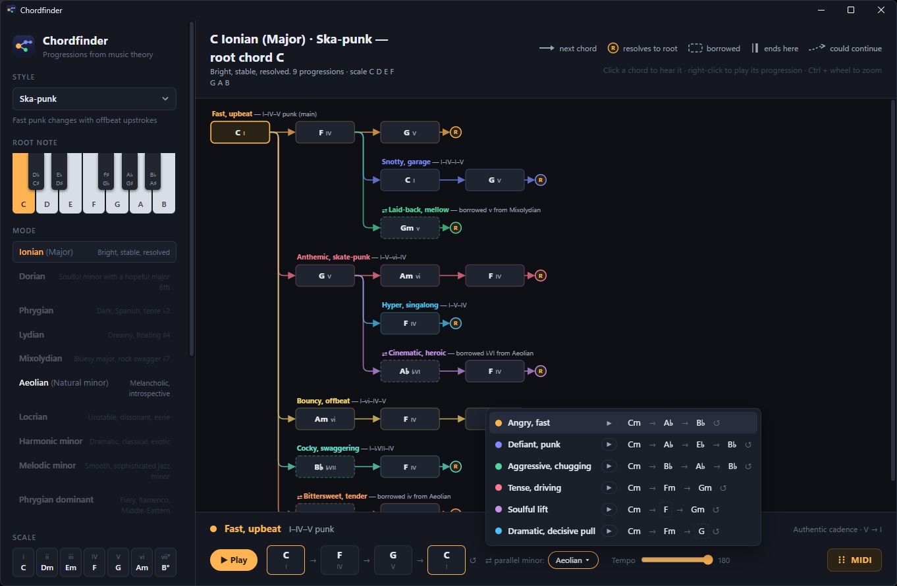
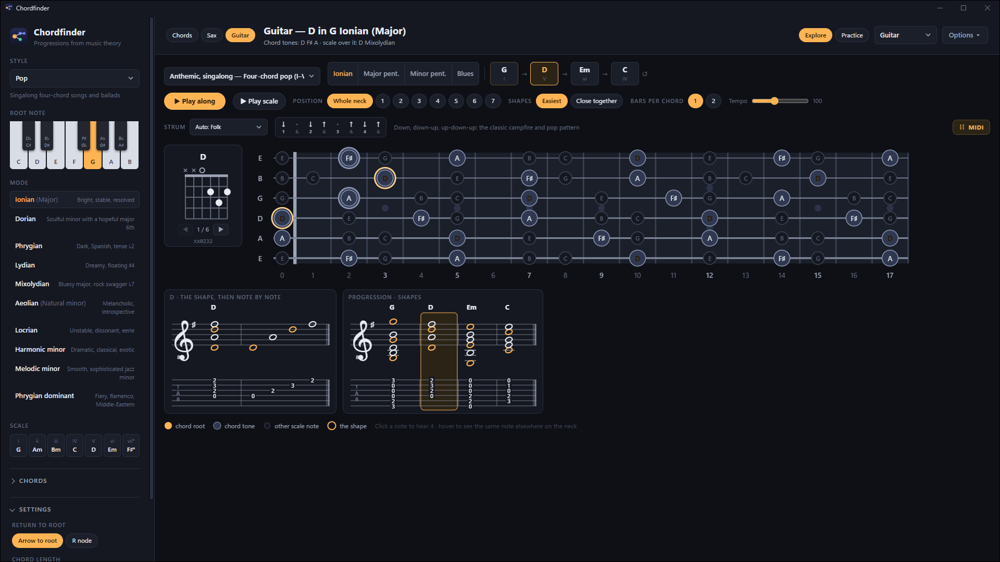

# Chordfinder

> [!NOTE]
> This is a vibe-coded app I made for my own use. I'm sharing it in case anyone else finds it useful, but there's no guarantee it will be maintained.

**Maps out chord progressions from music theory and drops them into your DAW as MIDI.**


## Features

- **Any key, 10 modes**, spelled correctly (E♭ Dorian, not D♯)
- **Branching map** of progressions from the root chord, with mood labels and cadence names
- **15 genre styles** plus 5 video game styles (Zelda, Castlevania, Double Dragon …)
- **Root chord options**: 7ths, sus, add9, power chords and more
- **Borrowed chords** from parallel modes, dashed in the map
- **Parallel mode shift**: preview and jump to C minor from C major
- **Listen**: click a chord, right-click a progression, Space to play
- **Guitar diagrams** under each chord, optionally strummed (pattern picker or Off)
- **MIDI drag-out**: whole progression, or a single chord as a one-bar clip
- **Phrase or loop** length
- **8 themes**, rounded or boxy corners
- **Small**: ~3 MB, about 45 MB of RAM



### Sax view


- Soprano, alto, tenor or bari, written or concert pitch
- Range grid with octave and palm-key registers
- Scales, chord tones and chord-scales
- Guide-tone line and play-along
- Staff notation with the right key signature and clef
- Fingering charts in three styles
- Tuner, play-it-back and practice drills
- Printable practice sheet and melody MIDI

### Guitar view



- Guitar or bass, scale notes on the neck
- Chord shapes, with close-together voice leading
- Pentatonic boxes and 3-notes-per-string positions
- Staff and tab
- Strumming patterns, or your own, as MIDI
- Note drills and a string tuner

## Download

Get it from [Releases](../../releases): Windows (`setup.exe` or portable `.zip`), macOS (`.dmg`), Linux (`.AppImage` or `.deb`).

The builds aren't signed:

- **Windows**: **More info** → **Run anyway**
- **macOS**: right-click → **Open**, or `xattr -dr com.apple.quarantine /Applications/Chordfinder.app`

## Building from source

Chordfinder is built with [Tauri 2](https://tauri.app): a Rust shell around a plain HTML/JS interface with no front-end build step and no npm dependencies.

**Requirements**

- Windows 10 or 11 with the Microsoft Edge WebView2 runtime (included with Windows 11)
- [Rust](https://rustup.rs) 1.77 or newer
- [Node.js](https://nodejs.org) 22 or newer — only for running the tests

**Build and run**

```bash
cargo build --release
```

The app is written to `target/release/chordfinder.exe`. For a debug build that opens straight away, use `cargo run`.

**Run the tests**

```bash
npm test
```

The tests check note spelling, chord building, every key × mode × option combination, the layout, the borrowed-chord rules, the MIDI files byte by byte, the sax view's transposition, staff layout, fingerings, pitch detection and drills, and the guitar view's chord shapes, positions, tab, strumming patterns and drills.

**Releases**

[`.github/workflows/build.yml`](.github/workflows/build.yml) builds Windows, macOS and Linux versions on GitHub Actions. Push a tag that matches `version` in `tauri.conf.json` (for example `v0.4.0`) to get a draft release with all files attached, or use **Run workflow** on the Actions tab for a test build.

## How it works

| File | What it does |
| --- | --- |
| `ui/theory.js` | The music theory: scales and spelling, chords from Roman numerals, the progression library, borrowed chords and cadence names |
| `ui/styles.js` | The genre styles: each one's progressions per mode and its defaults |
| `ui/graph.js` | Merges progressions into a branching tree and lays it out |
| `ui/midi.js` | Chord voicing (shared with the synth) and the MIDI file writer |
| `ui/audio.js` | A tiny Web Audio synth for previews and play-along |
| `ui/horn.js`, `ui/staff.js`, `ui/fingering.js` | The sax view: transposition, scales and chord-scales, staff layout, fingering charts |
| `ui/guitar.js`, `ui/strum.js`, `ui/fretquiz.js` | The guitar view: chord shapes, the neck, positions, tab, strumming patterns and note drills |
| `ui/pitch.js`, `ui/mic.js`, `ui/mic-worklet.js` | The tuner: pitch detection and microphone capture |
| `ui/quiz.js` | The practice drills and scoring |
| `ui/app.js`, `ui/index.html`, `ui/style.css` | The interface |
| `src/main.rs` | The native window, title-bar colours and the MIDI drag-out |

All the theory, layout and MIDI code is plain JavaScript without DOM access, so it runs and is tested in Node as-is.

Chords are written as Roman numerals relative to the major scale (`♭VI`, `♭VII`, `iv`, `V/V` …), the usual convention for modal and pop harmony. To add a progression, add a line to `LIBRARY` in `ui/theory.js` (or to a style in `ui/styles.js`) with its mood, name, chords and whether it resolves:

```js
p('Bittersweet, tender', 'Borrowed minor iv', ['IV', 'iv']),
```

## Platform support

Tested on Windows. MIDI drag-out and the themed title bar are Windows-only.

## License

[MIT](LICENSE) © 2026 Sidar Talei
